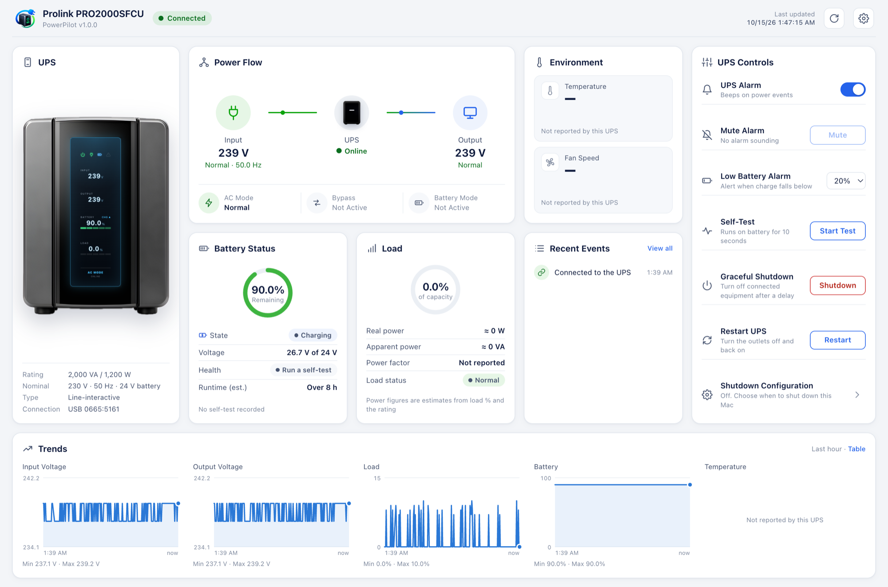
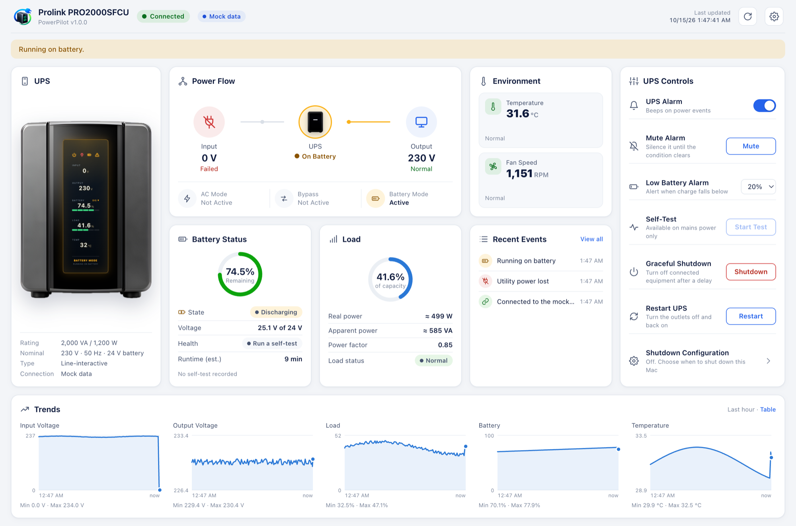

<p align="center">
  
</p>

<h1 align="center">PowerPilot</h1>

<p align="center">
  Desktop dashboard and background service for USB UPSes, on macOS, Windows and Linux.
</p>

<p align="center">
  <a href="https://github.com/tlmanz/PowerPilot/releases/latest"></a>
  <a href="https://github.com/tlmanz/PowerPilot/actions/workflows/release.yml"></a>
  <a href="go.mod"></a>
  
  <a href="https://github.com/tlmanz/PowerPilot/releases"></a>
</p>



A desktop dashboard and background service for USB UPSes that speak the Megatec/Voltronic protocol (USB `0665:5161`, e.g. the **Prolink PRO2000SFCU**). It runs on macOS, Windows and Linux, and is written in Go (standard library only, plus cgo on macOS for IOKit and WebKit).

- **Service:** polls the UPS every 2 s, serves the dashboard on `http://127.0.0.1:8484`, logs events, sends notifications, and can shut the computer down during a long outage. It starts at login:
  - **macOS:** a LaunchAgent.
  - **Linux:** a systemd user unit.
  - **Windows:** a per-user Run entry.
- **App:** opens the dashboard and starts the service on first launch.
  - **macOS:** `PowerPilot.app`, a native window.
  - **Windows and Linux:** an Edge/Chrome/Chromium app window, or the default browser.

## During a power outage



During an outage:
- The UPS display and the Power Flow switch to battery.
- The alarm banner appears.
- **Mute** becomes available.
- Events are logged and a notification is sent.

This view uses the built-in mock data: open `http://127.0.0.1:8484/?source=mock&scenario=battery`. Other scenarios are `bypass` and `fault`.

## Logs

The service keeps events and readings on disk, one file per day. Readings are averaged per minute, with the input voltage range and peak load.
- **Browse:** open the calendar button or **View all**, then pick a day.
- **Export:** download a range of days as CSV.
- **Retention:** Settings sets how many days to keep (90 by default). Older days are deleted.

| OS | Folder |
|---|---|
| Linux | `~/.local/state/PowerPilot/logs` |
| macOS | `~/Library/Application Support/PowerPilot/logs` |
| Windows | `%LocalAppData%\PowerPilot\logs` |

## Cloud (optional)

PowerPilot can also work with a PowerPilot server (`powerpilot-server`, in the PowerPilotHardware repo). In **Settings > Cloud**, paste a pairing link from the server's admin page and pick a mode:

| Mode | What PowerPilot does |
|---|---|
| Off | As before: the UPS on this computer's USB |
| Remote | No USB. It shows a UPS from the server, such as one an ESP32 reports, with the same dashboard, controls and logs. |
| Publish | It reads the USB UPS as before, and also sends it to the server. The phone app can then see it and send it commands. |

- **Notifications and shutdown in Remote mode:**
  - You get the same desktop notifications as with USB: power lost and restored, low battery, faults.
  - If the UPS is out of sight for 2 minutes, you're told.
  - "Shut down this Mac during a power outage" works too, as long as this computer can still reach the server.
- **Publish mode buffers:** while the server can't be reached, PowerPilot keeps events and readings, up to a day of them, and sends them when it's back.
- **The token stays out of the dashboard:** the setting is saved in `cloud.json` next to `settings.json`, readable by you only, and the token is never shown again.
- **Changing the mode restarts the service.**

## Requirements

| | Supported |
|---|---|
| macOS | 12 Monterey or newer, Apple Silicon or Intel |
| Windows | 10 or 11, x64 or ARM64. The app window uses Edge or Chrome. |
| Linux | x64 or ARM64 with systemd. The app window uses Chrome or Chromium, otherwise the default browser. |
| UPS | USB ID `0665:5161`, Megatec/Voltronic "PMV" protocol (e.g. Prolink PRO2000SFCU) |
| Building from source | Go 1.26 or newer ([`go.mod`](go.mod)). macOS builds also need the Xcode command-line tools (for cgo). |

## Install a release

Download from [Releases](https://github.com/tlmanz/PowerPilot/releases):

| OS | Steps |
|---|---|
| macOS | Unzip, move `PowerPilot.app` to Applications, and open it. The first time, right-click it and choose **Open**: it isn't notarized. |
| Windows | Unzip somewhere permanent and run `PowerPilot.exe`. On the SmartScreen warning, choose *More info → Run anyway*. |
| Linux | Install the udev rule (needs `sudo`), then run `powerpilot install`. `INSTALL.txt` in the archive has the exact commands. |

Remove the service with `powerpilot uninstall` (on macOS: `PowerPilot.app/Contents/MacOS/powerpilot uninstall`).

## Develop

```sh
make test        # vet (all OSes) + unit tests
make hwtest      # read-only queries against the attached UPS
make run         # service in the foreground
make app         # dashboard window against a running service
make install     # macOS: build PowerPilot.app into ~/Applications and start the service
make dist        # release archives for every OS into dist/ (VERSION=v1.2.3)
```

| OS | Settings | Logs |
|---|---|---|
| macOS | `~/Library/Application Support/PowerPilot/settings.json` | `~/Library/Logs/PowerPilot.log` |
| Linux | `~/.config/PowerPilot/` | `journalctl --user -u powerpilot` |
| Windows | `%AppData%\PowerPilot\` (logs here too) | `%AppData%\PowerPilot\` |

## Releasing

Push a version tag. [`.github/workflows/release.yml`](.github/workflows/release.yml) runs the tests, builds every archive with `scripts/build-release.sh`, and publishes a GitHub Release using the notes in `packaging/release-notes.md`:

```sh
git tag v1.0.0 && git push origin v1.0.0
```

Release archives:

| OS | Archive |
|---|---|
| macOS | A universal (Intel + Apple Silicon) `PowerPilot.app` |
| Linux | `powerpilot` + udev rule, for amd64 and arm64 |
| Windows | `PowerPilot.exe` (GUI subsystem), for amd64 and arm64 |

`SHA256SUMS.txt` comes with them. The macOS app is ad-hoc signed and the Windows exe is unsigned. Proper signing needs an Apple Developer ID and a code-signing certificate.

## Dashboard code

The UI in `internal/web/static/` is plain HTML, CSS and ES modules. Every component renders from **one UPS state object**, defined in `js/state.js`:

| Function | Renders |
|---|---|
| `updateUPSState(state)` | Everything, by calling the functions below |
| `updateUPSDisplay(state)` | The display overlay |
| `updateBattery(state.battery)` | Battery status card |
| `updatePowerFlow(state.mode)` | Power-flow diagram |
| `updateAlarm(state.alarm)` | Alarm controls |
| `addEvent(event)` | Adds one row to Recent Events |
| `updateCharts(state)` | The five trend charts |

**Data sources** live in `js/sources/` and share one interface: `start`, `command`, `saveSettings` and `refresh`.
- `live.js` reads the local service through `/api/state`, server-sent events and `/api/command`.
- `mock.js` simulates a UPS. Open `http://127.0.0.1:8484/?source=mock`, optionally with `&scenario=battery|bypass|fault`.
- To use another backend (WebSocket, Web Serial, …), add a source with the same interface. No UI changes needed.

**The UPS image** is `assets/ups-front.png`, an unbranded front view generated with FLUX.2 [dev] on Cloudflare Workers AI from the reference sheet, then cut out with macOS Vision. Readings are never part of the image: the display is an HTML overlay pinned to the glass at left 32.50%, top 10.78%, width 34.56% and height 74.95% of the image. Change those numbers in `.lcd` if the image is replaced. `assets/ups-flow.png`, the small UPS in the Power Flow card, was generated the same way from the UPS in `desktop.png`.

**Alarm controls:**
- **UPS Alarm** turns the beeper on or off persistently.
- **Mute** works only while an alarm is sounding, and turns the beeper back on automatically once the condition clears.

## Where each number comes from

| Shown | Source |
|---|---|
| Voltages, frequency, load %, battery V, status flags | UPS `QS` reply |
| Ratings (230 V, 8 A, 24 V battery, 50 Hz) | UPS `F` reply |
| Battery charge % | ViewPower's formula, reproduced exactly (see below) |
| VA / W, runtime | **Estimates.** VA/W = load % × rating (`-rated-va 2000 -rated-w 1200`, check the label). Runtime is our own Peukert model; set the battery Ah in Settings (default 9 Ah per 12 V battery). |

This UPS doesn't report temperature, serial number, or model (`I`, `QID`, `Q1`, `QPI`, `QGS` are echoed back as unsupported).

## Protocol notes (reverse engineered from ViewPower)

The UPS answers `M` with `V`, which ViewPower handles with its **PMV** processor. Commands are `\r`-terminated ASCII sent as zero-padded 8-byte HID output reports; the reply arrives in 8-byte input reports.

**`QS` status bits** (left to right):
1. utility fail
2. battery low
3. AVR
4. fault
5. line-interactive
6. test running
7. shutdown active
8. beeper on

**Work mode:**
- standby (output < 20 V)
- line
- test
- battery
- fault (overrides the others)

**Battery % per 12 V block** (block voltage v = pack voltage ÷ blocks):
- **On mains:**
  - v ≥ 13.5 V gives 100%.
  - 13.3–13.5 V starts at 90% and adds 1% every 12 minutes, up to 100%.
  - Otherwise ⌊90·(v−11.6)/1.7⌋.
- **On battery:**
  - Load < 20%: 100% above 13.2 V, otherwise ⌊100·(v−10.2)/3.0⌋.
  - Load ≥ 20%: 100% above 12.7 V, otherwise ⌊100·(v−10.2)/2.5⌋.

So a fully charged battery shows 90% for up to two hours after the service starts. ViewPower does the same.

**Controls:**

| Action | Command |
|---|---|
| 10 s self-test | `T` |
| Cancel test | `CT` |
| Beeper | `Q` (a toggle, so the service checks the beeper bit first) |
| Outlets off after delay *d*, restart after *m* min (`R0000` = stay off) | `S<d>R<mmmm>` |
| Cancel shutdown / outlets on | `C` |

*d* is `.2`–`.9`, or `01`–`10` minutes.

ViewPower offers no deep or timed test for this protocol, so neither does this dashboard.
